<p align="center">
  
  
  
</p>

<h1 align="center">GOAD-Light — From Empty Subnet to Golden Ticket</h1>

<p align="center">
  A hands-on write-up of <b>GOAD-Light</b> (Game of Active Directory by Orange Cyberdefense):<br>
  an isolated lab with three hosts and two domains, compromised end to end<br>
  — with commands, analysis of every output, MITRE ATT&CK mapping, remediation and detection.
</p>

---

## TL;DR

No exploit, no CVE, no malware. A single unprivileged domain user was enough:

| Step | What | Result |
|---|---|---|
| **Recon** | `nxc smb` across `192.168.56.0/24` | 3 hosts, 2 domains, SMB signing off on `CASTELBLACK`, null sessions on both DCs |
| **Enumeration** | anonymous `--users` | 10 accounts; one carries its password in the AD `Description` field |
| **Credential access** | AS-REP Roasting → Kerberoasting | `brandon.stark` → domain credentials → `jon.snow` → `iknownothing` |
| **Machine account** | `MachineAccountQuota = 10` | created `TestPC$` as a normal user |
| **Delegation** | RBCD | local `Administrator` hash on `WINTERFELL` |
| **Domain secrets** | DCSync | full `north` dump, including `krbtgt` |
| **Forest** | Golden Ticket + Enterprise Admins SID | `KINGSLANDING` (forest root) — `Pwn3d!` |

## Lab at a glance

| Host | IP | Domain | Role | SMB signing | Null auth |
|---|---|---|---|---|---|
| KINGSLANDING | `192.168.56.10` | `sevenkingdoms.local` | Forest root DC | ✅ | ✅ |
| WINTERFELL | `192.168.56.11` | `north.sevenkingdoms.local` | Child DC | ✅ | ✅ |
| CASTELBLACK | `192.168.56.22` | `north.sevenkingdoms.local` | Member server | ❌ | ❌ |

## Attack path

```mermaid
flowchart LR
    A["Anonymous SMB<br/>null sessions"] --> B["10 usernames"]
    B --> C["AS-REP Roasting<br/>brandon.stark"]
    C --> D["iseedeadpeople"]
    D --> E["Kerberoasting<br/>jon.snow"]
    E --> F["iknownothing"]
    F --> G["MachineAccountQuota = 10"]
    G --> H["TestPC$ machine account"]
    H --> I["RBCD"]
    I --> J["Local Administrator hash"]
    J --> K["DCSync"]
    K --> L["krbtgt"]
    L --> M["Golden Ticket<br/>+ EA SID 519"]
    M --> N["KINGSLANDING<br/>forest root"]
```



## Findings

| # | Finding | Severity | Affected | MITRE ATT&CK |
|---|---|---|---|---|
| 1 | SMB signing disabled — NTLM Relay candidate | **High** | `CASTELBLACK` | T1557.001 |
| 2 | Kerberos pre-authentication disabled | **High** | `brandon.stark` | T1558.004 |
| 3 | Kerberoastable service account with a dictionary password | **High** | `jon.snow` | T1558.003 |
| 4 | Write access on a computer object enables RBCD | **High** | computer objects | T1098 |
| 5 | `MachineAccountQuota` = 10 — any user can create machine accounts | **Medium** | domain-wide | T1136.001 |
| 6 | Anonymous SMB sessions allow user enumeration | **Medium** | both DCs | T1087.002 |
| 7 | Password hint exposed in the account description | **Medium** | `samwell.tarly` | T1087.002 |
| 8 | LDAP signing and channel binding not enforced | **Medium** | domain-wide | T1557 |
| 9 | DCSync available to a compromised account | **Critical** | `north.sevenkingdoms.local` | T1003.006 |
| 10 | `krbtgt` compromise — inter-realm Golden Ticket | **Critical** | forest | T1558.001 |

Every finding is mapped to MITRE ATT&CK and paired with concrete remediation and detection guidance in the reports.

## Reports

| Part | Covers | Link |
|---|---|---|
| **1** | Recon → anonymous enumeration → AS-REP Roasting → Kerberoasting | [report/goad-light-part1.md](report/goad-light-part1.md) |
| **2** | Credential validation → MAQ → RBCD → DCSync → Golden Ticket | [report/goad-light-part2.md](report/goad-light-part2.md) |

## Repository structure

```
goad-light/
├── README.md                       ← you are here
├── report/
│   ├── goad-light-part1.md         ← recon → credential access
│   └── goad-light-part2.md         ← domain admin → golden ticket
└── assets/                         ← 33 screenshots, numbered in reading order
    ├── 01-root-shell.png
    ├── ...
    └── 33-golden-ticket-pwn3d.png
```

## Skills demonstrated

`NetExec` · `Nmap` · `enum4linux` · `mitm6` · `Impacket (GetNPUsers, GetUserSPNs, addcomputer, rbcd, getST, ticketer, secretsdump, lookupsid)` · `John the Ripper` · `Evil-WinRM` · Kerberos abuse (`AS-REP Roasting`, `Kerberoasting`, `Golden Ticket`, SID history) · `MachineAccountQuota` · RBCD · DCSync · cross-domain trust abuse · output analysis and reporting · remediation and detection mapping

## Scope and ethics

Everything in this repository was performed inside an **isolated training lab** (`192.168.56.0/24`, virtual machines, no external network). Credentials and hashes that appear on screenshots are the lab's publicly documented defaults — they authenticate nothing outside the lab.

This is a learning artefact, not an attack kit. Do not run any of this against systems you do not own or lack written permission to test.

## Status

Both parts complete: the lab is fully compromised, from an empty subnet to the forest root.
